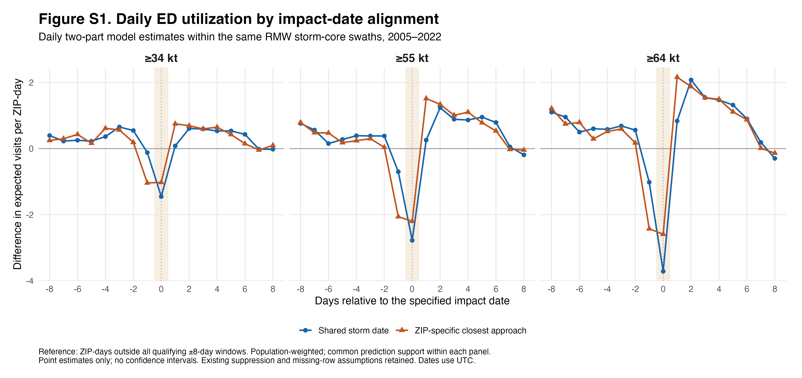

# Supplementary information: sensitivity to impact-date alignment

**Figure S1. Daily emergency department utilization by impact-date alignment.**
Population-weighted differences in modeled expected emergency department (ED)
visits per ZIP-day relative to non-storm conditions, estimated separately for
each day from eight days before to eight days after the specified impact date.
Panels show nested storm-intensity thresholds of ≥34, ≥55, and ≥64 kt. Blue
circles use a common date for all exposed ZIP areas within each storm: the date
of the first retained IBTrACS track segment whose radius-of-maximum-wind (RMW)
buffer intersects Florida. Orange triangles use the date of closest approach
to an interior representative point of each ZIP Code Tabulation Area (ZCTA).
The shaded band marks day zero. Both alignments retain the same RMW-based
exposure swaths and ZIP-area intersection rule. Models include ZIP,
year-month, and day-of-week fixed effects and a population offset in the
Poisson component. Predictions are standardized to the same ZIP-days with
finite predictions under both alignment models within each panel and averaged
using population weights. The available ED extract supports May-November
analyses for 2005-2022, with 39, 19, and 10 contributing storms at the respective
thresholds. Points are exploratory estimates; confidence intervals are not
shown. The existing assumptions about suppressed counts and missing records
are retained. Dates use UTC.

## Supplementary methods

We assessed sensitivity to impact-date alignment by replacing the three storm
phase indicators with 17 daily event-time indicators, spanning days -8 through
+8. ZIP-days outside the selected storms' event windows formed the reference
category; day -1 was not the reference. Separate two-part models were fitted
for each alignment and storm-intensity threshold.

ZIP-specific closest approach was calculated using the existing qualifying
IBTrACS line segments whose RMW buffers intersect Florida. Each ZCTA's interior
representative point was projected onto each retained segment for that storm.
The location with the shortest projected distance was selected, and its time
was interpolated linearly between successive track-fix timestamps. The UTC
calendar date containing that time defined local day zero. This is a geographic
timing proxy rather than an estimate of the time of maximum wind at a patient's
location; the representative point is not population-weighted.

The logistic component modeled the probability of an ED count reported at the
suppression threshold of six, and the Poisson component modeled counts above
six. As in the existing analysis, combined predictions were calculated as
`6p + (1-p)m`, where `p` is the predicted suppression probability and `m` is the
predicted conditional count above six. This retains the assumed suppressed-group
mean of six and the assignment of unmatched ZIP-days to zero. Annual ACS
population estimates were interpolated linearly, with the nearest available
estimate carried to years outside each ZCTA's available range. Nonpositive
population values were set to one, following the existing pipeline.

Overlapping event windows were resolved using the existing priority rule:
Impact over Threat over Cleanup. Ties within a phase were resolved by choosing
the event day closest to zero, followed by storm identifier. There were 10
overlapping ZIP-days under shared-date alignment and eight under local-date
alignment at ≥34 kt; no overlaps occurred at the higher thresholds. As in the
existing threshold-specific analysis, windows of excluded lower-intensity
storms could enter the reference category.

The prediction population was restricted to rows with finite predictions from
both model components under both alignments within each threshold. This
restriction accommodates ZIP fixed effects dropped because of no variation
in the suppression indicator. The standardization populations contained 667,
663, and 625 ZIP areas at the respective thresholds. Threshold panels therefore
do not represent an identical target population or an independent test of
intensity differences. Joint uncertainty accounting for shared storm exposure
has not yet been estimated for these exploratory curves.

## Supplementary results

The reduction in ED utilization around impact and the subsequent increase
were evident under both alignments. Day-zero differences under shared-date
alignment were -1.45, -2.78, and -3.71 expected visits per ZIP-day at ≥34, ≥55,
and ≥64 kt, respectively. Corresponding estimates under ZIP-specific alignment
were -1.02, -2.20, and -2.59, representing approximately 21-30% smaller
day-zero reductions. The minimum under ZIP-specific alignment occurred on day
-1 at ≥34 kt and day zero at the two higher thresholds.

Equal-weight averages of the daily contrasts over days -1 through +1 remained
negative under both alignments: -0.50 versus -0.44 visits per ZIP-day at ≥34 kt,
-1.07 versus -0.91 at ≥55 kt, and -1.30 versus -0.95 at ≥64 kt (shared versus
ZIP-specific alignment). These averages summarize the daily estimates rather
than coefficients from refitted three-day-window models. The comparison
indicates that the exact day-zero magnitude is sensitive to temporal alignment,
while the broader pattern persists descriptively. No formal test of differences
between alignments is reported.

## Suggested main-text reference

"An exploratory daily event-time analysis using ZIP-specific closest-approach
dates yielded smaller day-zero reductions but retained the reduction around
impact and the subsequent increase in ED utilization (figure S1)."

## Reproducibility

- Analysis: `scripts/daily_event_time.R`
- Figure rendering: `scripts/plot_daily_event_time.R`
- Daily estimates: `output/event_time/daily_estimates.csv`
- Timing summaries: `output/event_time/timing_summary.csv`
- Sample audit: `output/event_time/sample_audit.csv`
- ZIP-storm date comparison: `output/event_time/zip_storm_alignment.csv`

Drafting checks before submission: confirm the ED date convention against UTC
storm dates, reconcile the main manuscript's period and event counts with the
available extract, confirm suppression/missing-row assumptions, and decide
whether to add joint uncertainty intervals to figure S1.
