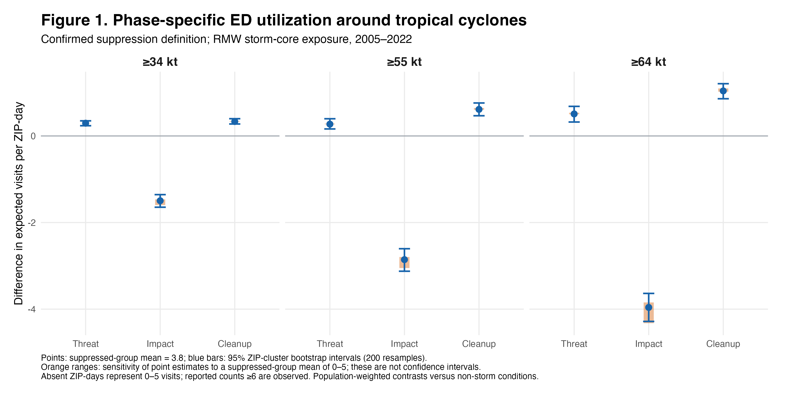

# Supplementary information: corrected suppression and impact-date sensitivity

## Confirmed suppression definition and prediction assumptions

The data provider confirmed that counts of one through five visits were suppressed. Zero-count ZIP-days were also absent from the extract. An absent ZIP-day was therefore treated as an interval-observed count between zero and five; reported counts of six or more were treated as observed. Absent records were not assigned an observed count of zero, and reported sixes were not labeled as suppressed.

The logistic component modeled the probability of an absent (0–5 visit) ZIP-day, p. The count component modeled the conditional mean m among observed ZIP-days with at least six visits, using a Poisson working mean model. Combined expected visits were calculated as c p + (1-p)m. The central figures use c = 3.8 visits, David Hsu's estimate from comparison with county totals. The provider confirmed the interval 0–5; it did not establish this mean. Sensitivity analyses varied a common c across the full interval from zero to five. This assumes the suppressed-group mean is constant across ZIP-days and phases for each sensitivity scenario; these ranges are not identification bounds allowing phase-specific means to vary independently.

The count component includes ZIP, year-month, and day-of-week fixed effects and an annual ZIP population offset. The logistic component uses the same fixed effects. Population-weighted counterfactual predictions were averaged over ZIP-days with finite component predictions. As in the original pipeline, multiple reported rows within a ZIP-day were summed. The available extract supports May–November 2005–2022; the 2004 storm season is absent.

## Figure 1: corrected phase estimates

**Figure 1. Phase-specific ED utilization around tropical cyclones under the confirmed suppression definition.** Population-weighted differences in expected emergency department (ED) visits per ZIP-day relative to non-storm conditions, by storm phase and nested storm-intensity threshold. The RMW-based exposure swaths, shared storm dates, and phase definitions are retained. Points use a suppressed-group mean of 3.8 visits. Blue bars show 95% percentile intervals from 200 resamples of entire ZIP histories, with both model components refitted on the same ZIP draw in each replicate. Orange ranges show sensitivity of the point estimates to a common suppressed-group mean of zero through five; they are not confidence intervals. Bootstrap intervals condition on the selected mean. The ZIP bootstrap retains the original inference design and does not resolve dependence across ZIPs affected by the same storm.

Differences in expected visits per ZIP-day, with 95% ZIP-bootstrap intervals in brackets:

| Threshold | Threat | Impact | Cleanup | Non-storm baseline |
|---|---:|---:|---:|---:|
| ≥34 kt | 0.29 [0.24, 0.35] | -1.50 [-1.65, -1.35] | 0.33 [0.28, 0.40] | 16.44 |
| ≥55 kt | 0.27 [0.16, 0.40] | -2.86 [-3.12, -2.60] | 0.61 [0.47, 0.76] | 16.45 |
| ≥64 kt | 0.51 [0.32, 0.68] | -3.96 [-4.28, -3.64] | 1.04 [0.86, 1.21] | 16.56 |

## Figure S1: daily event-time sensitivity

**Figure S1. Daily ED utilization by impact-date alignment under the confirmed suppression definition.** Daily differences in population-weighted expected ED visits per ZIP-day relative to non-storm conditions, from eight days before through eight days after the specified impact date. Panels show nested ≥34, ≥55, and ≥64 kt storm thresholds. Blue circles use a common date for all exposed ZIP areas within each storm: the date of the first retained IBTrACS track segment whose RMW buffer intersects Florida. Orange triangles use the date of closest approach to an interior representative point of each ZIP Code Tabulation Area. The vertical band marks day zero. Both alignments retain the same RMW swaths and ZIP-area intersection rule. Lines use a suppressed-group mean of 3.8; shading shows sensitivity to a common mean from zero through five. No sampling confidence intervals are shown in Figure S1. Dates use UTC.

The three phase indicators were replaced with 17 daily indicators spanning days -8 through +8. ZIP-days outside all selected storms' event windows were the reference; day -1 was not the reference. Separate models were fitted by threshold and alignment. For local timing, each ZIP area's interior representative point was projected onto retained qualifying track segments, the closest location was selected, and its timestamp was interpolated linearly between successive track fixes. This is a geographic timing proxy, not the time of maximum wind at individual patient locations or a population-weighted ZIP center.

Within each threshold, both alignment curves use the same ZIP-day prediction population. These populations contain 671, 667, 630 ZIP areas at ≥34, ≥55, and ≥64 kt, respectively. There are 39, 19, 10 contributing storms at those thresholds. Differences across threshold panels remain descriptive because their target populations differ and their storm samples are nested.

Overlapping event windows follow the original Impact > Threat > Cleanup priority, with ties within a phase resolved by the event day closest to zero and then storm identifier. At ≥34 kt, ten ZIP-days overlap under shared-date alignment and eight under local-date alignment; higher thresholds have none. Windows of storms excluded by an intensity threshold can enter that threshold's reference category, retaining the original analysis design.

The following summaries use the central suppressed-group mean. Three-day values are equal-weight averages of daily estimates over days -1 through +1, not coefficients from a refitted three-day-window model.

| Threshold | Shared date: day zero | ZIP-specific date: day zero | Shared date: three-day mean | ZIP-specific date: three-day mean |
|---|---:|---:|---:|---:|
| ≥34 kt | -1.50 | -1.07 | -0.52 | -0.46 |
| ≥55 kt | -2.86 | -2.22 | -1.08 | -0.93 |
| ≥64 kt | -3.96 | -2.69 | -1.37 | -1.02 |

## Suggested Methods wording

> Daily ZIP-code counts of one through five ED visits were suppressed by the data provider. Because zero-count ZIP-days were also absent, an absent ZIP-day represented an unknown count from zero to five. Reported counts of six or more were treated as observed. We modeled the probability of an absent record using logistic regression and modeled counts among observed records using a Poisson conditional-mean model. Combined expected visits used a suppressed-group mean of 3.8, estimated from comparison with county totals, with sensitivity analyses varying this common mean from zero to five.

## Reproducibility and remaining author checks

- Corrected fits and bootstrap: `scripts/regenerate_suppression_figures.R`.
- Figure rendering: `scripts/plot_suppression_figures.R`.
- Numerical outputs and audits: `output/suppression_corrected/`.
- Figures made before the correction are archived in `figs/archive_before_suppression_correction_2026-10-18/`.

Before submission, document the county-total calculation supporting 3.8 (including geographic and encounter coverage), verify ED date conventions against UTC storm dates, reconcile main-text years and event counts, and address the reviewers' storm-dependence concern. Earlier event-time CSVs in `output/event_time/` are retained as historical results and are superseded by the corrected outputs.
